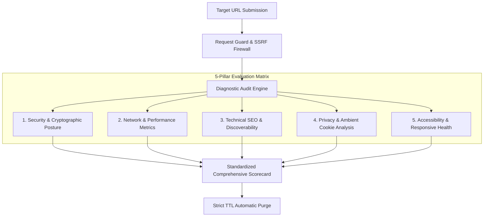

<div align="center">

# 🌐 XeooAuditor
### **Privacy-First Public Website Auditing Toolkit**

[](https://react.dev)
[](https://www.typescriptlang.org)
[](https://tailwindcss.com)
[](https://vitejs.dev)
[](https://www.php.net)
[](https://www.mysql.com)

[](#-privacy-charter)
[](#-security-architecture)
[](#-accessibility--ui-standards)
[](#-license)

<p align="center">
  <b>Audit any public website instantly without accounts, cookies, or intrusive telemetry.</b><br />
  A next-generation diagnostic suite delivering deep security, performance, SEO, and privacy insights.
</p>

---

</div>

## 🌟 Executive Overview

**XeooAuditor** is a specialized, privacy-centric website auditing platform engineered to deliver thorough, verifiable diagnostic assessments for public web applications. 

Unlike traditional auditing tools that demand mandatory account creation, plant tracking beacons, or store visitor history indefinitely, XeooAuditor is constructed from the ground up on the principle of **Zero-PII Ephemerality**. Visitors submit a target URL, observe instantaneous multi-vector verification across five technical audit pillars, and download their audit findings immediately.

```
┌────────────────────────────────────────────────────────────────────────┐
│                        XEOO AUDITOR PIPELINE                           │
│                                                                        │
│   Public URL       SSRF & Network       Multi-Pillar      Ephemeral    │
│  [ Input URL ] ──> [ Boundary Guard ] ─> [ Evaluators ] ─> [ Report ]  │
│                           │                    │               │       │
│                     Blocks RFC1918      5 Core Domains     Purged on   │
│                     & Cloud Metadata    Analyzed Cleanly    Schedule   │
└────────────────────────────────────────────────────────────────────────┘
```

---

## ⚡ Core Technical Pillars



<details open>
<summary><b>1. Security Posture & Cryptographic Hardening</b></summary>
<br>

- **Modern TLS/SSL Verification**: Inspects cipher suite strength, validity lifespan, and certificate authority legitimacy without bypassing verification flags.
- **HTTP Response Security Headers**: Validates presence and strictness of `Content-Security-Policy`, `Strict-Transport-Security` (HSTS), `X-Frame-Options`, `X-Content-Type-Options`, `Referrer-Policy`, and `Permissions-Policy`.
- **Clickjacking & MIME-Sniffing Defenses**: Detects framing vulnerabilities and dangerous content-type overrides.
</details>

<details>
<summary><b>2. Network Diagnostics & Performance Sizing</b></summary>
<br>

- **Protocol Negotiation**: Assesses HTTP/2 and HTTP/3 support for multiplexed asset streaming.
- **Payload & Response Budgets**: Monitors raw payload transfer sizes, gzip/brotli compression utilization, and response latency.
- **Cache Strategy Validation**: Examines `Cache-Control`, `ETag`, and conditional caching indicators.
</details>

<details>
<summary><b>3. Technical SEO & Crawl Architecture</b></summary>
<br>

- **Robots Directives & Ingestion Rules**: Parses `robots.txt` syntax, crawl-delay directives, and disallow boundaries.
- **Sitemap XML Validation**: Tests discoverability of XML sitemap declarations.
- **Meta & Structured Graph Integrity**: Audits canonical URL consistency, OpenGraph tags, and semantic metadata hierarchy.
</details>

<details>
<summary><b>4. Privacy & Third-Party Footprint</b></summary>
<br>

- **Tracker & Beacon Exposure**: Flags intrusive third-party analytics and tracking pixels.
- **Ambient Cookie Classification**: Identifies cross-site trackers, missing `Secure` or `HttpOnly` cookie flags, and lax `SameSite` configurations.
- **Zero-Storage Philosophy**: Guarantees user-submitted audit targets are not indexed, harvested, or traded.
</details>

<details>
<summary><b>5. Accessibility & UX Foundations</b></summary>
<br>

- **Viewport & Dynamic Scaling**: Verifies responsive mobile layouts, touch target adequacy, and meta-viewport boundaries.
- **Semantic Structure**: Audits heading cascades (`h1`-`h6`), landmark tags, and alternative text indicators.
- **High-Contrast Design**: Built in alignment with WCAG 2.1 AA visual contrast standards.
</details>

---

## 🛠️ Technology Stack

XeooAuditor combines a high-performance, strictly-typed reactive frontend with an enterprise-grade, memory-efficient PHP REST backend.

### **Frontend Interface**
- **Framework & Runtime**: React 19 (Strict Mode, Concurrency-Optimized)
- **Language**: TypeScript 5+ (Strict Type Checking, Zero `any`)
- **Build Tool**: Vite 8 (Sub-second HMR, Tree-Shaken Production Chunks)
- **Styling Architecture**: Tailwind CSS v4 + Semantic Design Tokens CSS (`--color-surface`, `--color-brand`, etc.)
- **Iconography**: Lucide React (Clean, geometric technical icons)
- **Notifications**: SweetAlert2 (Dark-themed, accessible feedback dialogs)

### **Backend Diagnostic Engine**
- **Core Runtime**: PHP 8.4 REST Architecture
- **Database Abstraction**: Native PDO with 100% Parameterized Statements & Strict Types (`declare(strict_types=1)`)
- **Authentication & Sessions**: Single-Active-Session Policy, Argon2id Password Cryptography, Cryptographic Bearer/Cookie Session Guard
- **Rate Limiting**: Sliding-Window IP/User Rate Limiter with Persistent Defense Tracking
- **Security Guardrails**: `RequestGuard` (SSRF Defense, DNS Rebinding Prevention, Same-Origin Enforcement)

### **Data & Persistence Layer**
- **RDBMS**: MySQL 8.0 / MariaDB
- **Data Protection**: Zero-PII retention policies, aggregate-only operational error monitoring, automatic audit data eviction

---

## 🛡️ Security Architecture & SSRF Defenses

XeooAuditor executes requests to user-submitted URLs on behalf of the client. To ensure the audit engine cannot be leveraged as an attack vector, strict network isolation is enforced:

```
                  ┌─────────────────────────────────────┐
                  │    Target URL Validation Matrix     │
                  └──────────────────┬──────────────────┘
                                     │
                   ┌─────────────────┴─────────────────┐
                   ▼                                   ▼
         [ Scheme Validator ]               [ DNS Resolution Guard ]
       Only `http` & `https` allowed       Resolve host to IP before connect
                   │                                   │
                   ▼                                   ▼
       [ Prohibited Destination ]          [ Private Range Filter ]
       Reject localhost, 127.0.0.1         Block RFC 1918 (10.0.0.0/8,
       Reject cloud metadata endpoints     172.16.0.0/12, 192.168.0.0/16,
       (e.g., 169.254.169.254)             100.64.0.0/10, Carrier NAT)
                   │                                   │
                   └─────────────────┬─────────────────┘
                                     │
                                     ▼
                   [ Hardened Connection Handshake ]
                   Strict TLS verification & timeouts
```

- **Fail-Closed Design**: If hostname resolution yields an unverified or mixed IP address, the request is terminated immediately.
- **Redirection Hop Caps**: Strict cap on HTTP redirection hops prevents infinite loops or redirect-based SSRF evasion.
- **Resource Constraints**: Strict limits on max download bytes (2MB default) and request timeout (8s default) preserve system availability.

---

## 🔒 Privacy Charter

1. **No Visitor Accounts Required**: Public users never create accounts, provide emails, or authenticate to execute audit scans.
2. **Zero Target Harvesting**: XeooAuditor does not maintain a searchable public repository of scanned URLs or expose individual reports to third parties.
3. **No Credential Interception**: Scans never store cookies, authorization headers, or sensitive session variables from target websites.
4. **Aggregate Operational Health**: The administrative telemetry layer records aggregate system health, service metrics, and sanitized error fingerprints only.
5. **Scheduled Ephemeral Purging**: Temporary audit cache rows and operational session records are systematically purged according to strict retention schedules.

---

## 🎨 UI/UX System & Accessibility

XeooAuditor's user interface is built adhering to the **ui-ux-pro-max** design specification:

- **Strict Color Tokens**: Built on a single source of truth in `design-tokens.css`, guaranteeing visual coherence across dark and high-contrast modes.
- **Keyboard Operable**: Full keyboard focus visibility (`:focus-visible`), skip links, and ARIA compliant dialogs.
- **Reduced Motion Support**: Automatically respects `prefers-reduced-motion: reduce` OS preferences.
- **Restrained Iconography**: Clean, minimalist geometric iconography. Strict ban on decorative, magical, or generic cybersecurity symbols.

---

## 🤝 Responsible Security Disclosure

We welcome responsible security research. If you discover a vulnerability or security flaw:
- Please report it through our secure **Contact Portal** selecting the **Security Disclosure** category.
- Do not execute destructive attacks, denial of service, or extract data belonging to other systems.
- Valid submissions are promptly triaged and resolved.

---

<div align="center">
  <sub>Designed & Developed with precision. Built for privacy, speed, and uncompromising technical clarity.</sub>
  <br>
  <sub>© XeooAuditor. All rights reserved.</sub>
</div>
